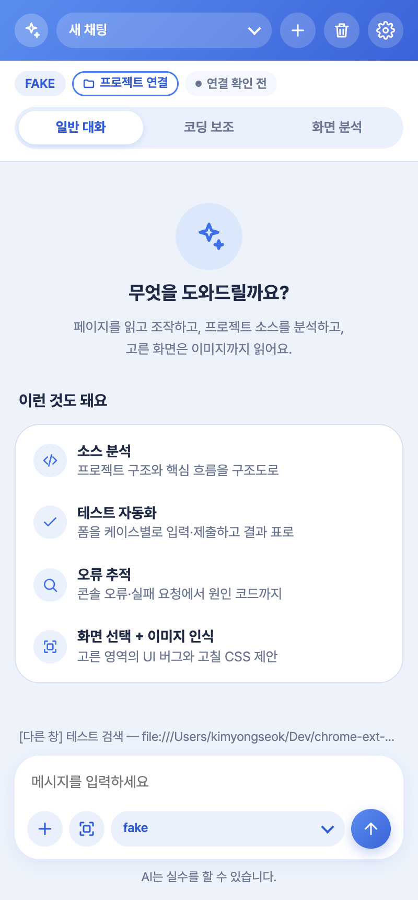
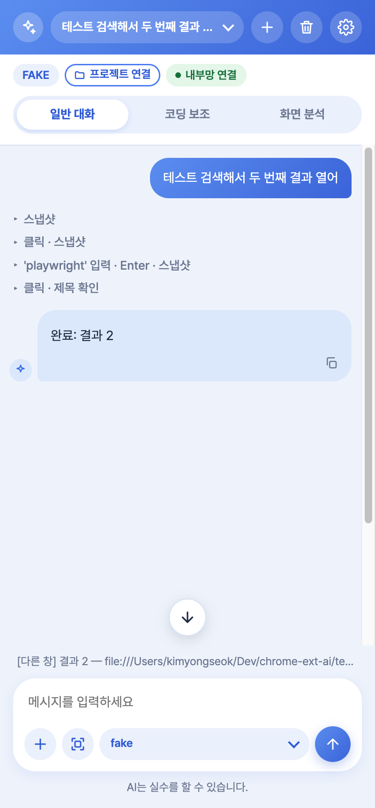
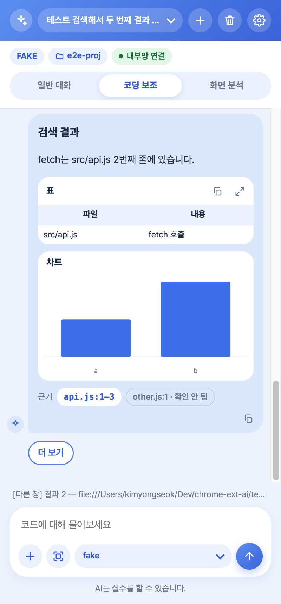
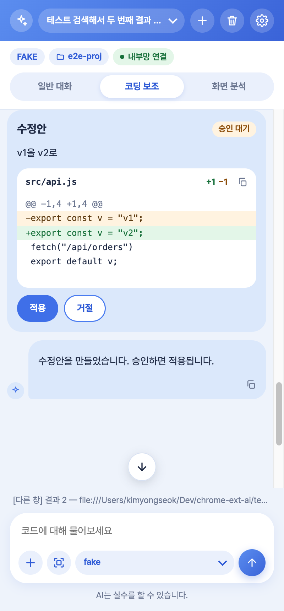
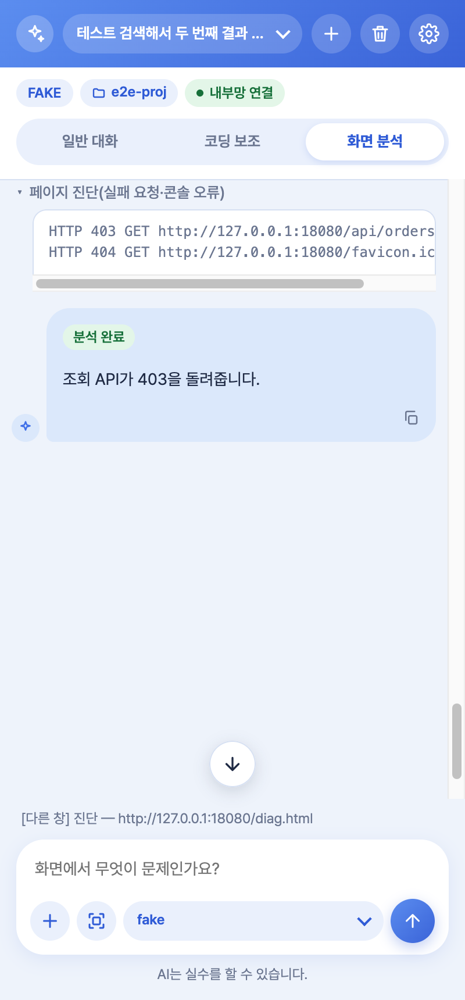
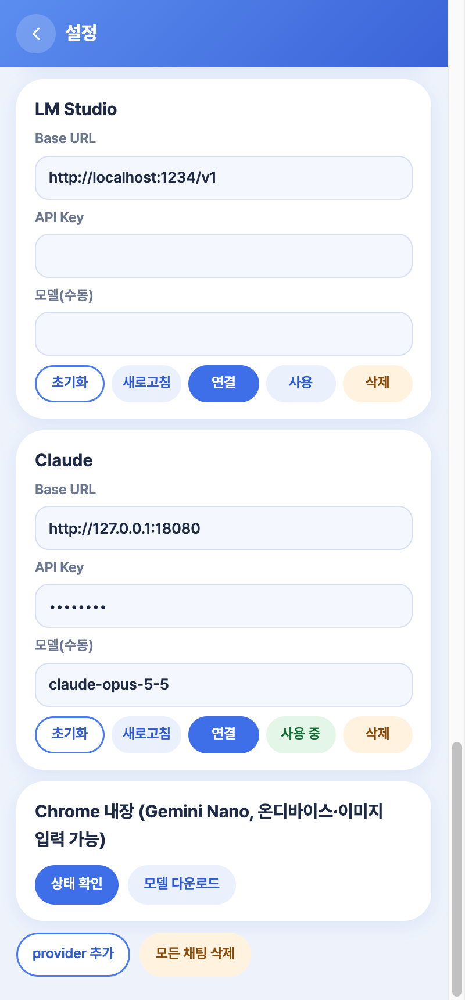

# chrome-ext-ai 로컬 LLM Agent를 이용한 크롬 확장프로그램

크롬 옆 사이드 패널의 AI 비서. 지금 보는 페이지를 접근성 트리로 읽고 CDP로 클릭·입력하며, 연결한 프로젝트 소스를 읽어 파일·줄 근거와 함께 답하고, 고른 화면은 이미지까지 읽는다. 모델은 내부망 vLLM·Ollama·LM Studio(OpenAI 호환), Claude API, Chrome 내장 AI 중에서 고른다. 확장 폴더 하나로 동작하고 Node·데몬·CDN이 필요 없다(폐쇄망 대상).

## 화면

| 시작 | 페이지 대신 조작 | 코딩 보조 답변 |
|:---:|:---:|:---:|
|  |  |  |
| 상태 배지·모드 탭, 개발자 기능 예시 | 조작 단계는 회색 줄, 누르면 코드·결과 | 표·차트·파일:줄 근거, 읽지 않은 근거는 "확인 안 됨" |

| 수정안 승인 | 화면 오류 진단 | 설정 |
|:---:|:---:|:---:|
|  |  |  |
| Diff 확인 후 적용해야 파일 변경, 되돌리기 | 실패 요청·콘솔 오류로 원인 추적 | 서버별 초기화·새로고침·연결·사용·삭제 |

캡처는 자동 테스트(`E2E_SHOTS=<폴더> node test/e2e/run.mjs`)가 실제 확장을 실행하며 찍은 것이라 모델 배지가 테스트용 `FAKE`로 보인다.

## 주요 기능
- **모드**: 일반 대화(페이지 조작) · 코딩 보조(프로젝트 폴더 검색·읽기·수정안) · 화면 분석(실패 요청·콘솔 오류 진단)
- **화면 선택**: 드래그한 영역의 구조와 이미지를 함께 첨부(Chrome 내장 AI 또는 동봉 SmolVLM이 이미지 설명)
- **코드 수정**: 찾아 바꾸기 수정안 → Diff → 승인 시에만 적용, 파일이 바뀌었으면 거부, 되돌리기·감사 기록
- **테스트 실행**: Windows용 선택 설치 파일 `native-host/`(PowerShell, 허용 목록 명령만)
- **Rich 응답**: 표·코드·차트·구조도·탭·후속 질문, 생각·진행 실시간 표시
- **모델 자동 전환**: 고른 서버가 실패하면 목록 아래의 설정된 서버로 넘어가고 안내

## 설치
1. `chrome://extensions` → 개발자 모드 → 압축해제된 확장 프로그램 로드 → `extension/`
2. 패널 열기(툴바 아이콘 또는 Cmd+E) → 설정 → Base URL·API 키·모델 입력

## 브라우저 내 SmolVLM (이미지 설명 보조)
- 라이브러리는 `extension/vendor/`에 동봉(Transformers.js 4.3.1, onnxruntime-web wasm). 모델 파일은 `node scripts/download-model.mjs`로 `extension/models/`에 내려받음(SmolVLM-256M, 약 550MB, git 제외). 폐쇄망은 그 폴더째 반입.
- Chrome 내장 Nano가 없을 때 이미지 설명을 대신함. WebGPU 있으면 fp16/q4, 없으면 CPU(wasm)에서 fp32/q8.
- Gemma 4 E2B(3.4GB)는 시도했으나 wasm 커널 미지원·WebGPU 크래시로 제외(2026-10-16).

## 문서 첨부
- docx·pptx·xlsx·hwpx: 내장 `DecompressionStream`으로 zip을 풀어 XML에서 본문 추출(의존성 없음).
- pdf: `vendor/pdf.min.mjs`(pdf.js, Apache-2.0). hwp: `vendor/rhwp.js`+`rhwp_bg.wasm`(rhwp, MIT, 11MB).
- 파일당 50KB·합계 60KB를 넘는 본문은 잘라서 첨부(32k 컨텍스트).

## 테스트
- 단위: `npm test` (node --test, 의존성 없음)
- e2e: `node test/e2e/run.mjs` (Chromium + 가짜 LLM, 오프라인)
- 수동: `docs/manual-test.md`
